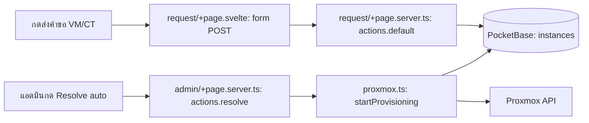

# init.d — กดแล้วโค้ดไปไหน

| ผู้ใช้ทำอะไร | ตามไฟล์และฟังก์ชัน | ผลลัพธ์ |
| --- | --- | --- |
| เลือก preset | [request/+page.svelte](src/routes/request/+page.svelte) `handlePresetSelect()` | เติมค่า spec ในฟอร์ม ยังไม่สร้าง instance |
| กดส่งคำขอ VM/CT | `<form method="POST">` ใน [request/+page.svelte](src/routes/request/+page.svelte) → `actions.default` ใน [request/+page.server.ts](src/routes/request/+page.server.ts) → PocketBase `instances`; เรียก [discord-webhook.mjs](src/lib/server/discord-webhook.mjs) | สร้างคำขอและแจ้ง Discord |
| แอดมินกด Resolve แบบ auto | form ใน [admin/+page.svelte](src/routes/admin/+page.svelte) → `actions.resolve` ใน [admin/+page.server.ts](src/routes/admin/+page.server.ts) → `startProvisioning()` ใน [proxmox.ts](src/lib/proxmox.ts) | บันทึกผู้อนุมัติและเริ่มสร้าง VM/CT บน Proxmox; ติดตามสถานะต่อ |
| แอดมิน Resolve แบบ manual | `actions.resolve` ใน [admin/+page.server.ts](src/routes/admin/+page.server.ts) | ตั้งสถานะ completed ใน `instances` และส่ง Discord notification |
| แอดมินกดลบ | `actions.delete` ใน [admin/+page.server.ts](src/routes/admin/+page.server.ts) → `deleteInstance()` ใน [instance-lifecycle.ts](src/lib/server/instance-lifecycle.ts) → Proxmox | ลบ resource และคงประวัติ record ตาม lifecycle |
| กด power / console | [api/instance-power/+server.ts](src/routes/api/instance-power/+server.ts) หรือ [api/console/+server.ts](src/routes/api/console/+server.ts) | ตรวจสิทธิ์ก่อนส่งคำสั่งไป Proxmox |

อ่าน [คู่มือระบบ](../Docs/HandOn/init-d.md) สำหรับ state provisioning และสิทธิ์
