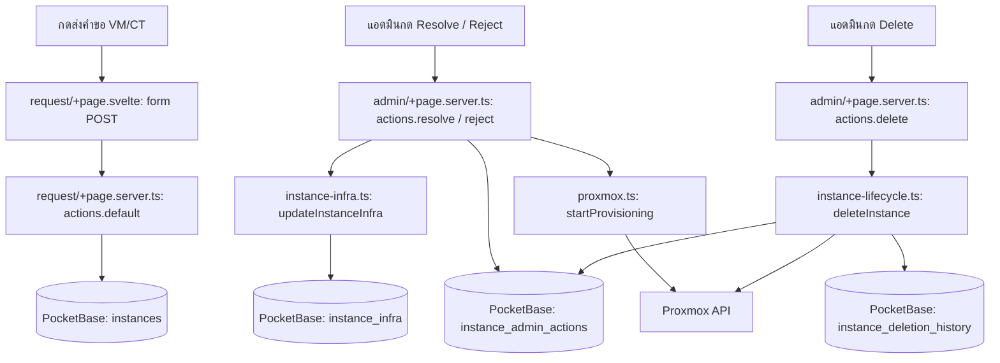

# init.d — กดแล้วโค้ดไปไหน

| ผู้ใช้ทำอะไร | ตามไฟล์และฟังก์ชัน | ผลลัพธ์ |
| :--- | :--- | :--- |
| **เลือก preset** | [request/+page.svelte](src/routes/request/+page.svelte) `handlePresetSelect()` | เติมค่า spec ในฟอร์ม ยังไม่สร้าง instance |
| **กดส่งคำขอ VM/CT** | `<form method="POST">` ใน [request/+page.svelte](src/routes/request/+page.svelte) → `actions.default` ใน [request/+page.server.ts](src/routes/request/+page.server.ts) → PocketBase `instances`; เรียก [discord-webhook.mjs](src/lib/server/discord-webhook.mjs) | สร้างคำขอและแจ้ง Discord |
| **แอดมิน Resolve (Auto/Manual)** | `actions.resolve` ใน [admin/+page.server.ts](src/routes/admin/+page.server.ts) → `getInstanceWithInfra()` & `updateInstanceInfra()` ใน [instance-infra.ts](src/lib/server/instance-infra.ts) → [proxmox.ts](src/lib/proxmox.ts) | บันทึกผู้อนุมัติลง `instance_admin_actions`, อัปเดต Proxmox state ลง `instance_infra`, และเริ่มสร้างเครื่องบน Proxmox |
| **แอดมิน Reject** | `actions.reject` ใน [admin/+page.server.ts](src/routes/admin/+page.server.ts) | บันทึกเหตุผลการปฏิเสธลง `instance_admin_actions` และแจ้งเตือนผู้ขอ |
| **แอดมินกดลบ** | `actions.delete` ใน [admin/+page.server.ts](src/routes/admin/+page.server.ts) → `deleteInstance()` ใน [instance-lifecycle.ts](src/lib/server/instance-lifecycle.ts) → Proxmox | ลบเครื่องบน Proxmox, บันทึกประวัติการลบลง `instance_deletion_history`, และบันทึก Audit ลง `instance_admin_actions` |
| **กด power / console** | [api/instance-power/+server.ts](src/routes/api/instance-power/+server.ts) หรือ [api/console/+server.ts](src/routes/api/console/+server.ts) | ตรวจสิทธิ์และดึง `vmid`, `node` จาก `instance_infra` ก่อนส่งคำสั่งไป Proxmox |

อ่าน [คู่มือระบบ](../Docs/HandOn/init-d.md) สำหรับ state provisioning และสิทธิ์
